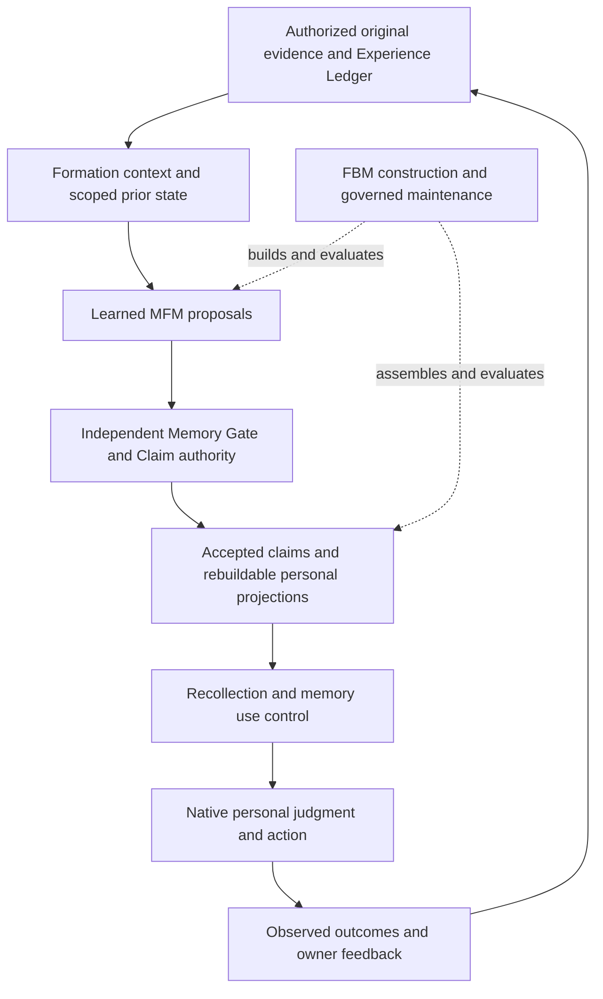

# MFM purpose and development alignment

The selected MFM direction remains consistent with Alice and Fable's purpose: a continuing personal intelligence that learns from a life, carries goals and relationships across time, makes its own evidence-grounded judgments, and learns from their consequences. The current construction is incomplete. Conditional-language training and source/target geometry are prerequisites; they do not establish learned memory formation, a personal entity, or automatic FBM assembly.

This audit distinguishes the destination, component evidence, actual prior design failures, and the remaining build. Its source revisions are Alice main `8ea804aa25c3d1c5f46e9be5810d072ed0fadb4b`, Fable main `a6eba323dd27d3c58f232b351d09b86761b15935`, MFM `6f20edef306b634dc108cef20669680c1025b019`, FBM `46a8385b6888a20825c7711fc51c4be47a6332b2`, and frontier research `5e9795e3e3543c70ec4e1ebf375857f674f87cfb`. Source hashes and original Git blob identities are in the companion public receipt. Subsequent component construction remains separately reviewed.

## The entity we are building

Alice's continuity resides in evidence, memories, identity, beliefs, goals, decisions, skills and relationship history across replaceable models and devices. Alice reconstructs an authorized source personality while knowing she is a reconstruction; source history, host evidence, Alice's own experience and their relationship must remain distinct. Fable generalizes the capability for a new host with that host's own authorized evidence and developing identity. It does not transfer Alice's private biography, credentials or personal weights.

The complete 64-page *The Second Mind* storyboard supplies concrete behavioral destinations. Pages18–24 distinguish evidence, inference, unknowns, rehearsal and subjects;31–39 require independent disagreement, override lineage, mixed outcomes, tentative patterns, negotiated norms and tested procedures;40–42 require engine independence and evolving context;46–48 connect long missions, replanning and interaction strategy;49–56 require device continuity, derivative deletion, calibrated confidence and retrieval of rare decisive constraints. These behaviors remain obligations, not accomplished demonstrations. The clone-aware standard and personal-development architecture add source fidelity, inspectable development and selective, reversible learning.

Alice is the capability upstream. Transferable functionality flows through host-neutral contracts into Fable; personal content never does. Deployment phases and hardware profiles govern delivery order without becoming capability ceilings.

## MFM responsibility and authority

MFM is the learned interpreter between authorized experience and proposed memory development. It receives the experience actually opened, registered source identity and original locators, scope/permission/time/modality, the formation context, and meaningful authorized prior state. Retrieval candidates must carry their meaning and current state, rather than an arbitrary identifier that the model cannot interpret.

Its complete output is a structured proposal bundle: evidence-linked observations and interpretations, subject and epistemic class, known/valid time, uncertainty and sensitivity, conflicting alternatives, corrections and invalidation dependencies, episodic boundaries, overlapping scenes, goals and missions, tentative patterns, norms, skills, outcomes, and separate host/relationship/assistant-self development. It can abstain, retain raw experience, defer or seek missing evidence. A proposed inference or rehearsal remains an inference or rehearsal.

MFM does not own source truth, consent, accepted Claim writes, physical-store choice, personality reconstruction authority or final native judgment. Registry metadata helps interpret a stored candidate but cannot become newly observed source evidence or gain literal-copy authority. Fast capture preserves and indexes real experience. Slow formation/reflection proposes consolidation and learning without silently promoting its own output to history.

## Connections to the rest of Alice and Fable

| Piece | Required connection and boundary |
| --- | --- |
| Evidence and Experience Ledger | Preserve original artifacts and what actually occurred, including the opened evidence, decision rationale, owner override, attempted action and independently observed result. Predictions, scripted follow-ups and approving feedback do not become verified outcomes. |
| Memory Gate and Claim fabric | Authenticate provenance, subject, consent and revision dependencies; decide accepted bitemporal knowledge. MFM proposes and the gate adjudicates. |
| Episodes, cognitive graph, vectors and personal projections | Derive retrievable structure from accepted state, keeping provenance and correction/deletion lineage. Rebuildable accessibility scores do not become truth. Dynamic scenes are not a fixed Life/Work/Interest ontology. |
| Host, relationship, personality and assistant-self models | Consume their separately scoped evidence and accepted state. Source personality is not rewritten by an ordinary host event; Alice's later development cannot masquerade as source-person history. |
| Mission Graph and attention workspace | Keep canonical goals, dependencies, decisions, statuses and result capsules outside a chat or UI. MFM proposes relevance and changes; governed application and real execution/outcome evidence determine state. |
| Retrieval and native judgment | Open relevant evidence and apply IGNORE/BOUND/CONTROL appropriately. Demonstrate changed judgment for causally relevant memory and stability for irrelevant changes; a remote feature or conversation model does not own the verdict. |
| Lifecycle, training and devices | Propagate correction, revocation and deletion through projections, contexts/plans/cache and applicable learned influence; preserve export, recovery, rollback, device reconciliation and model replacement. Ordinary memory ingestion is not gradient-update authorization. |
| FBM | Inventory authorized sources, construct and evaluate the distinct learned components, assemble the entity, diagnose observed failures and propose governed updates. Runtime MFM shares some interpretation duties but does not replace FBM's broader bootstrap and maintenance role. |

Current Alice contracts select KurrentDB canonical events, NATS JetStream ingress/federation, XTDB bitemporal Claims, Qdrant, LadybugDB/NebulaGraph, original-object custody, Temporal and Valkey. These are selected implementations behind owned contracts, not proof that the full loop is activated. The physical-policy conflict described below must be resolved before Fable activation; it does not change MFM's neutral packet interface.

## What a full MFM shipment includes

1. A reloadable trained specialist with pinned licensed representation ancestry, processor/runtime and independently initialized learned role weights, reproducible data/objective/optimizer/parent lineage, and separate shared versus private custody. Gemma supplies the base representations; its chatbot answer head is not MFM.
2. Real authorized intake, adaptive context planning and meaningful prior-state inputs; learned typed reference selection, exact observed literal spans and warranted semantic authoring. References resolve against the actual caller inventory, including ambiguity and missing-state behavior.
3. Broad longitudinal and native-modality competence: changing preferences and goals, contradiction/correction/revocation, episode/scene formation, social/relationship/self distinctions, procedural/environment learning, and fast/slow consolidation. Text-only geometry cannot certify native media.
4. Actual governed consumer integration from proposal through accepted memory and retrieval into native judgment/action, followed by observed outcomes and selective revision. MFM is responsible for its part of this complete system rather than absorbing every infrastructure component.
5. Independent held-out people, source families, time windows and generator families; seeded-untrained and role-removal/swap controls; temporal evolution, abstention, false-memory and wrong-subject errors reported individually. Tests must judge warranted meaning and attribution rather than arbitrary local labels or one exact paraphrase. Critical failures cannot disappear in an aggregate loss.
6. Demonstrated deployment, privacy/isolation, resource behavior, exact-state restart, recovery, deletion and a second independent host's assembly. Full capability is not an unsupported claim of unlimited reliability from finite tests.

## Current evidence and design gaps

| Boundary | Evidence at the audited snapshot | Remaining obligation |
| --- | --- | --- |
| Public conditional-language foundation | S0 completed epoch3/step6864 of the unchanged E20/45760-update program; original41 outputs and recovery catalog have verified Drive custody. S1 launch/readback was accepted and observed RUNNING at00:26 UTC. | Actual S1 allocation/mount/model–Adam–RNG–cursor–history resume evidence is separate. Complete the fixed foundation and its frozen paired development evaluation. The restaurant-language task is not full formation. |
| Original source and complete target geometry | Actual offline Gemma source controls and full target-field controls; target69 owner and69 independent tests,40 actual-processor checks across3 cases. | These prove mapping/provenance boundaries, not learned selection, copying or entailment. Native geometry is incomplete. |
| Caller meaning | A reviewed successor design retains the original caller and adds scoped meaning/state for all available prior candidates; complete joint causal rendering is being constructed. | Its final implementation, actual-processor controls and independent admission are separate evidence. Existing E20 features do not already contain this new input. |
| Complete formation learning | Full-role responsibilities and downstream contracts are defined. Historical teacher fits exist but did not qualify the model. | Independent longitudinal worlds/priors, adequate admitted language and formation material, new explicit learning-stage recipe, learned full-role performance and governed consumer loop remain unfinished. |
| FBM | Rows49–100 preserve52 procedure traces, including construction failures, state continuation and custody. | Procedure-only traces are not an eligible builder corpus or demonstrated automatic new-host competence. |

Earlier failures identified actual design defects: prior candidate meaning was absent; local identifiers were not meaningful selection inputs; narrow exact-string scoring confused valid paraphrases with false memory; aggregate cross-entropy concealed omitted fields, rare lexical errors and invalid generated structure. Preserving those failures and changing the responsible input/learning/evaluation path is necessary. Repeating a fit or adding epochs without addressing those causes would divert the work.

There is also current documentation drift. FBM's README, licensed-assembly table and singleton seed projection lag later actual teacher/S0/S1 evidence. The FBM PostgreSQL/lighter-profile paragraph is historical relative to current Alice selected-stack contracts. Fable's current execution profile still specifies JetStream event authority and JanusGraph while Alice's current memory/execution/migration/StageG documents specify Kurrent authority, JetStream transport and NebulaGraph. Neither discrepancy proves a model failure. Both must remain explicit rather than allowing a stale page to determine a build or activation. Historical records remain intact; owned current pointers can be corrected without editing the other product branch.

## Build sequence from this point

Continue the immutable E20 run and evaluate its actual learned language/source response at its intended completion. In parallel, finish and independently admit complete target-free caller meanings and original source/target joins. Refusal on unsupported native geometry or genuinely missing prior state must stay explicit.

Next construct independently checkable multi-person longitudinal worlds and actual prior registries across the full formation duties, with training/development/final ancestry separated before optimization. Admit adequate broader conditional material only after rights, original evidence, split integrity and resource coverage are established. NQ's inspected license and an outside paper are research inputs, not admitted training material.

Specify the next learned reference/span/semantic integration against those real inputs and measured foundation behavior, comparing mechanisms by their fit to our responsibilities. Freeze its new task, objective, initialization/parent, optimizer and export recipe explicitly; changing formation inputs or loss is a new stage, not an E20 resume. Research mechanisms such as typed schema linking and generation/copy separation inform the design without importing an entire competing platform. Latest frontier work reinforces admissibility, evidence completeness and current-state validity; dual parametric memory remains a future challenger.

Then train and verify complete longitudinal/native formation, episodic and fast/slow behavior, and the accepted-memory → personal judgment/action → observed outcome/revision loop. Apply authorized private personalization after shared foundation competence. Prove second-host transfer and FBM assembly on independent evidence. Continue using available free compute and Drive custody; any paid route remains a last option requiring a concrete need and separate authorization.

## What FBM must retain to automate this

For every material construction operation retain the actual eligible input state and source/permission/subject map, alternatives and applicable constraints, chosen action or defer/abstain decision, independently checkable target or unresolved state, authority verdict, executed intervention and observed result, regressions, resources, and exact artifact/data/model/evaluator/parent lineage. Keep successes and failures, including faulty-test diagnoses and counterevidence. A public hash locator neither contains the private case nor grants access to it.

Procedure traces provide methods. Separately admitted, complete input–target–outcome cases teach a host-neutral builder; held-out new-host execution establishes transfer. Current authored fictional fixtures and the N0 curriculum do not supply that evidence. Historical compressed rows88–90 also require an explicit versioned normalization reader before uniform machine consumption; preserve original bytes and unknown fields rather than fabricate missing facts.

The alignment verdict is therefore conditional and concrete: the current role boundaries and chosen next construction are aligned; full capability remains unbuilt. The route loses alignment if conditional text fit, serializers or storage receipts become substitutes for meaningful prior inputs, learned full-role formation, governed outcomes or consumer transfer. Completion is measured by those original duties.

## Controlling source routes

Alice: `docs/MEMORY_IDENTITY_FORMATION_AND_HOST_LEARNING_ARCHITECTURE.md`, `docs/FABLE_PERSONAL_DEVELOPMENT_ARCHITECTURE.md`, `docs/ALICE_PHASE2_REPLACEMENT_AND_FABLE_V1_EXECUTION_PLAN_2026-09-27.md`, memory-v4/migration/StageG/use-control/performance standards, Phase5 mission/workspace/experience contracts, constitution, clone-aware standard and capability parity. Fable: `comic/STORYBOARD.md`, `docs/FIRST_RELEASE.md`, `docs/FABLE_V1_EXECUTION_PROFILE_2026-09-27.md`. Current MFM: [full build](MFM_FULL_CAPABILITY_BUILD_PLAN_2026-09-29.md), [licensed direction](MFM_V1_LICENSED_BASE_DIRECTION_2026-09-30.md), [full-role sequence](MFM_FULL_ROLE_SEQUENCE_SUCCESSOR_2026-10-07.md), [producer contract](MFM_PUBLIC_FOUNDATION_PRODUCER_CONTRACT_2026-10-07.md), [continuation](MFM_DEVELOPMENT_CONTINUATION_2026-10-09.md) and [TRACE100 evidence](receipts/MFM_FULL_TARGET_AND_S1_CONTINUATION_20261010_TRACE100_PUBLIC.json). FBM: architecture, data/seed program, licensed assembly, trace schema and parallel capture contract at the revision above.
